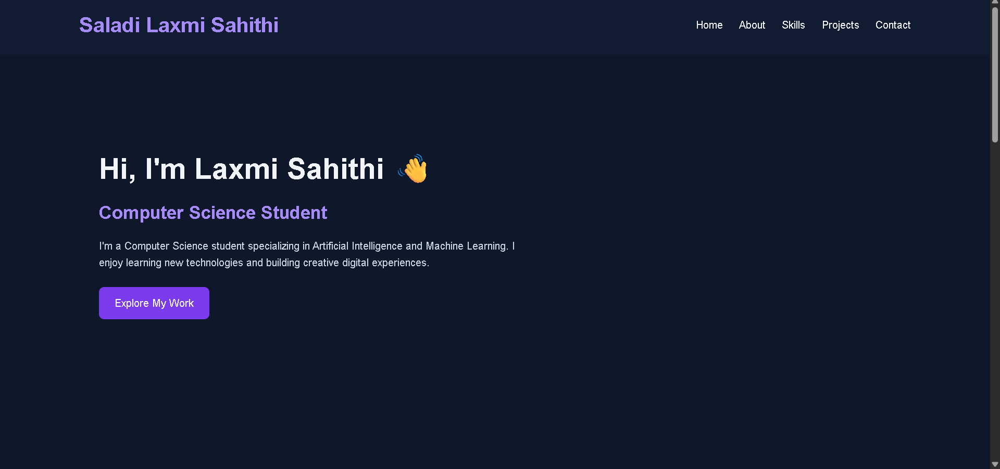

# 🌐 My Personal Portfolio

Welcome to my personal portfolio! This website showcases my introduction, technical skills, projects, and contact information.

## 👩‍💻 About Me

I am Laxmi Sahithi, a B.Tech Computer Science student specializing in Artificial Intelligence and Machine Learning (AIML).

I am passionate about web development, artificial intelligence, and game development. I enjoy learning new technologies and improving my programming skills.

## 🚀 Live Demo

[Visit My Portfolio](https://sahithi157.github.io/portfolio/)

## ✨ Website Sections

- **Home:** Introduction and welcome section.
- **About Me:** Information about my educational background and interests.
- **Skills:** Overview of my technical skills.
- **Projects:** Showcases my projects and learning journey.
- **Contact:** Contact information for connecting with me.

## 🛠️ Technologies Used

## 🎯 Purpose

This portfolio was created to showcase my skills, introduce myself, and share my learning journey as a computer science student.

## 📸 Website Preview

## 👩‍🎓 Author

**Laxmi Sahithi**

- GitHub: [@sahithi157](https://github.com/sahithi157)
- Portfolio: [My Personal Website](https://sahithi157.github.io/portfolio/)

---

⭐ Thank you for visiting my portfolio!
